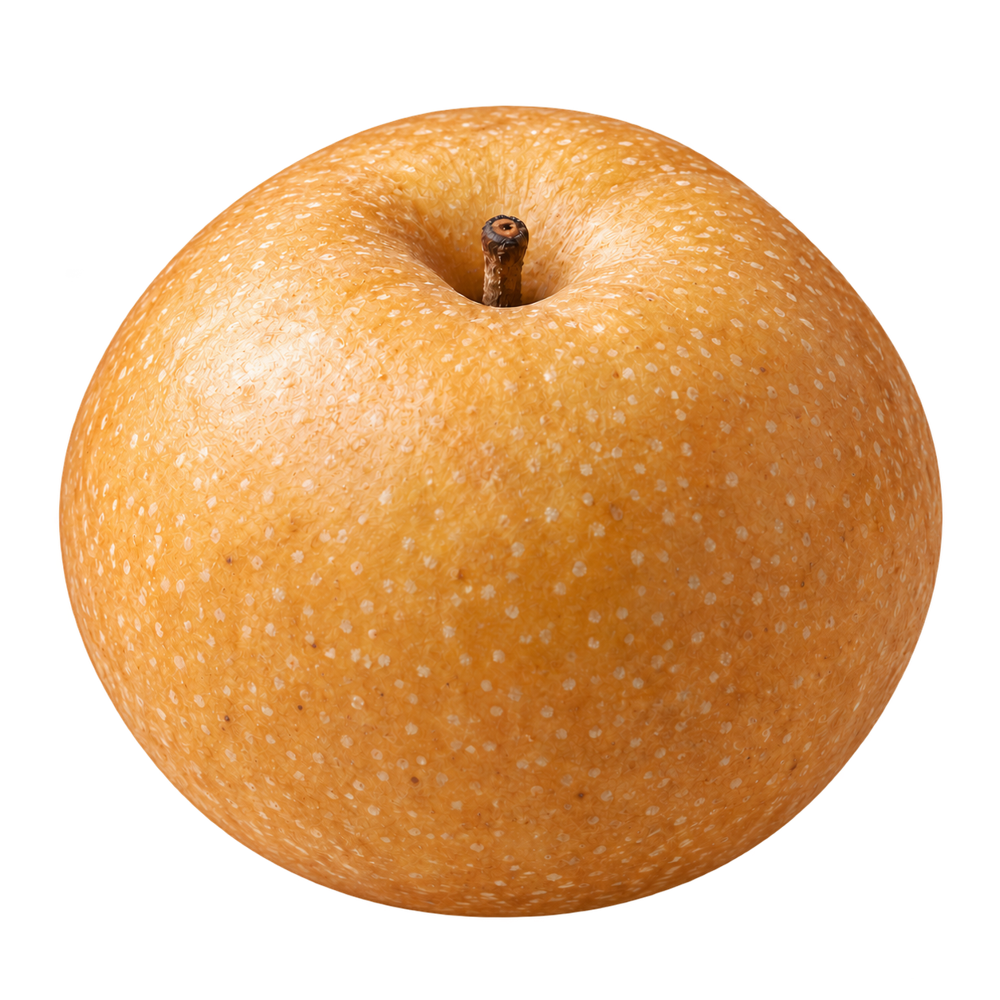

# Pear

**Windows Steam games on Apple Silicon, with simple setup and a free, open-source app.**

Pear prepares a Windows Steam environment so players can open their library without
learning Wine or configuring compatibility tools. The final goal is an experience
with **no Rosetta dependency** across every required process and library.

## Try Pear

The current **Pear release (Rosetta-based M3 route)** uses Rosetta, Wine and DXMT. Open Pear, sign
into official Windows Steam, then choose an owned game from your library. The app
and optional CLI share the same setup. Routine players should not need Terminal,
Xcode, a developer account or a paid compatibility app.

**[Download Pear for Mac](https://github.com/postmelee/pear/releases/download/v0.1.1/Pear-0.1.1-macos-arm64.dmg)** · [Website & game reports](https://postmelee.github.io/pear/) · [Release notes](https://github.com/postmelee/pear/releases/tag/v0.1.1)

Pear **0.1.1** uses **Wine 11.0 and DXMT 0.80** and requires
Apple Silicon, macOS 15+ and Rosetta. Megabonk gameplay, input/audio, saved
progress, recovery and a fresh standard-account installation were checked with
earlier releases on one M4 Pro / macOS 26.5.2 using the unchanged runtime.
Those results do not establish first-install correctness for every later app
version. Other hardware and games remain unverified.

| Start here | What you will find |
|---|---|
| [Use Pear](docs/rosetta-preview.md) | Availability, first Steam session, optional CLI and data preservation |
| [Game reports](docs/compatibility/README.md) | Tested configurations, limitations and how to share a result |
| [Get help](docs/SUPPORT.md) | Questions, bug reports and private reporting routes |
| [Make a first contribution](docs/development/getting-started.md) | Local checks, Preview build and contribution paths |
| [Develop without Rosetta](docs/development/rosetta-free.md) | Native component repositories, bounded reconstruction, current Issues and prerequisites |
| [Read the documentation](docs/README.md) | Tutorials, task guides, reference and explanation |

If 0.1.0 setup stopped with “This folder contains unrelated files”, quit Pear
with Command-Q and install the current app. Keep your Application Support data;
see [first-install recovery](docs/rosetta-preview.md#first-install-recovery).

Install with Homebrew: `brew install --cask postmelee/tap/pear`.
See [installation, updates and removal](docs/rosetta-preview.md#homebrew).

The final 0.1.1 signed app/CLI startup and the reused Wine runtime were checked in macOS
15.7.9 CI; this does not establish Steam UI or gameplay compatibility on macOS 15.
The gameplay evidence above remains from the unchanged runtime on macOS 26.

Pear checks for app updates at launch and offers optional game reporting.
Use **Window → Run history** to review runs and **Pear → Settings → Sharing**
to choose what to share. Nothing is sent until you confirm a sharing choice.
See [app updates](docs/rosetta-preview.md#app-updates) and
[reporting and privacy](docs/reporting-and-privacy.md).

## Two tracks, one goal

| Track | Current scope | Status |
|---|---|---|
| Rosetta Preview (M3) | Make Windows Steam preparation, launch and recovery easy | Public v0.1.1; macOS 15 startup checked; prior gameplay and recovery evidence on one macOS 26 Mac |
| Rosetta-free runtime (M1) | Run owned Windows Megabonk with every required host process and library free of Rosetta | Under development; no player-ready native preview |

The Rosetta-free runtime remains in development. Experimental builds have reached
Megabonk's menu, but gameplay and verification that every required process and
library runs without Rosetta remain incomplete.

Wine, FEX, DXMT and common-runtime source ownership are established. Their four
source repositories are publicly readable and use `master` for default access
and integration PRs. Selected runtime builds retain their exact commit pins.
Bounded runtime reconstruction and development-selector checks have passed;
retained build inputs are still required.
These checks do not qualify game compatibility. See the
[native development guide](docs/development/rosetta-free.md#split-native-development-components)
for prerequisites and ongoing work, and the
[Task #56 handoff report](mydocs/report/task_m1_56_report.md)
for the verified scope and remaining limitations.

Megabonk is the first validation game. Selecting another game in Steam does not
establish compatibility. [Recorded results](docs/compatibility/records.md) retain
failed, unknown and untested outcomes as well as successes. Menu interaction is
not sustained gameplay qualification.

The [delivery plan](docs/delivery-plan.md) is the single roadmap. Technical M1,
proposed ordinary-user M2, current M3 and independent CPU research R1 have distinct
acceptance criteria. The [architecture](docs/architecture.md) explains the intended
Wine/FEX/DXMT runtime and reuse choices. A native launcher alone does not meet M1.

## Contribute

Help with Preview setup and recovery, native runtime engineering, tests,
documentation, accessibility or game observations. You do not need an AI service
or programming experience to report a useful result. Start with the
[contributor guide](docs/contributing.md) and [community guide](docs/community.md).
Requests and votes express demand; they do not promise support or a delivery date.

Pear aims to keep official downloads free, publish reproducible component inputs,
record bounded compatibility evidence and preserve users' games and saves during
recovery. Performance, power and memory improvements require measurements; no
comparative claims are established.

## Game files and licensing

Pear is intended to work with game copies provided by users who own them. Game files, Steam account data, and extracted game code or assets are not included in this repository.

Copyright (C) 2026 Pear contributors.

Except where a file or directory specifies separate terms, original Pear code is
free software under the **GNU General Public License, version 3 or (at your
option) any later version**. See [LICENSE](LICENSE). Pear is provided without
any warranty, including implied warranties of merchantability or fitness for a
particular purpose; the full license gives the terms.

Existing third-party code, explicitly licensed fixtures and Hyper-Waterfall
materials retain their own licenses and attribution. This license does not apply
to Steam, Rosetta or games. See the [component record](preview/THIRD_PARTY_NOTICES.md)
and [contributor guide](docs/contributing.md). Official Pear downloads are intended
to be free of charge; GPL also permits others to redistribute copies for a fee.
