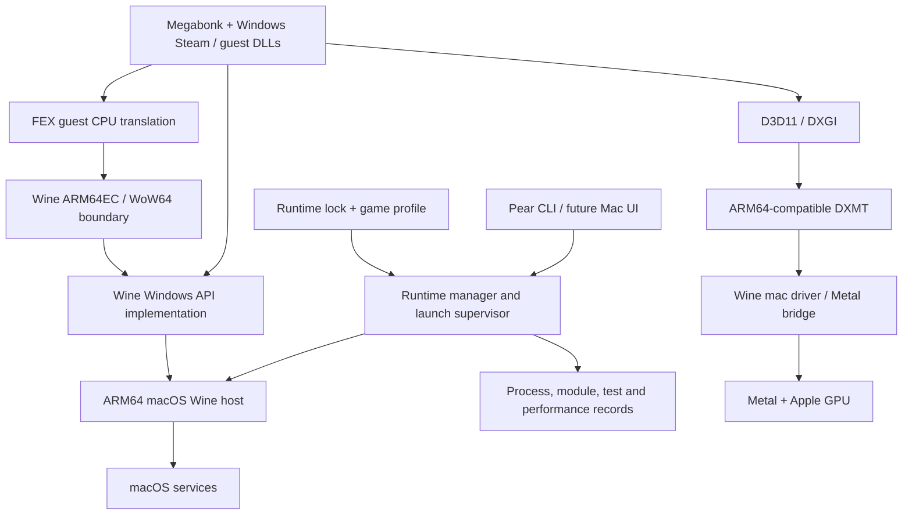

# Pear runtime architecture

Status: proposed implementation baseline, not an implemented runtime. Original evidence review: September 27, 2026; roadmap, repository status, contracts and manager-decision alignment: September 28, 2026.

## 1. Objective and engineering standard

The first technical runtime milestone, M1, is **Megabonk running on an Apple Silicon Mac without Rosetta**. Pear will own a reproducible compatibility runtime: its source and patch set, build definitions, macOS integration, component contracts, validation, and release process. A successful launch using an opaque collection of prebuilt libraries is insufficient.

Substantial Wine, FEX, or graphics integration work is in scope when required. Reuse is an engineering decision, not a restriction to launcher development. Rewriting a working subsystem requires evidence that its interface, correctness, performance, availability, or maintainability prevents the project from meeting its goals.

This document defines the target design. The [evidence summary](research/local-evidence.md) describes what has actually been tested. Detailed investigations cover [macOS and CPU runtime integration](research/macos-runtime-audit.md), [graphics and game integration](research/graphics-and-game-integration.md), and [language and engine alternatives](research/engine-and-language-options.md).

## 2. Requirements and boundaries

| ID | Requirement |
|---|---|
| R1 | Run the purchased Windows build of Megabonk on macOS/Apple Silicon without Rosetta in any required runtime process. |
| R2 | Build the compatibility runtime from identifiable source revisions and documented patches, using pinned toolchains and dependencies. |
| R3 | Use a documented signing and execution-permission path on a Mac with its normal security protections enabled. |
| R4 | Preserve Windows CPU/API semantics, Steam integration, input, audio, and save/load behavior. |
| R5 | Keep game files, credentials, saves, prefixes, and caches separate from immutable runtime artifacts. |
| R6 | Produce reproducible test records and detect incompatible component combinations before launching a game. |
| R7 | Keep subsystem boundaries explicit so an improved translator or renderer can be evaluated without rewriting the launcher or game profiles. |
| R8 | Judge performance and power use from controlled measurements. Rosetta independence does not imply lower power or higher frame rates. |

The initial test configuration is M4 Pro with macOS 26.5.2. It is a development baseline, not a declaration of support for every M-series Mac. The minimum OS and chip requirements will be set by verified APIs, permissions, and graphics capabilities.

A documented development-profile signing path under normal macOS protections may qualify the first technical milestone. General-user distribution without developer enrollment requires separate evidence and is not implied by that milestone. Report these outcomes independently.

The required runtime scope starts at the Pear launcher and includes Steam and any required helper, child process, native library, and loaded game module. Build tools are recorded separately: an Intel build tool is a reproducibility concern, while an Intel host process needed during play violates R1. Prefer ARM64 build tools as well.

Windows PE x64 binaries are expected guest code. Their presence is not itself a Rosetta dependency. A macOS Mach-O x86_64 process running through Rosetta is different. Universal binaries must be observed using the ARM64 slice; an ARM64 parent does not prove its children are ARM64.

Initial exclusions: a new Windows API implementation, a new GPU driver, kernel anti-cheat support, D3D12 as a release requirement, a general game decompiler, and browser execution. These may be separate research efforts; they do not establish the first milestone.

## 3. Architecture



The diagram separates responsibilities, not processes: CPU translation, Windows APIs, and the graphics bridge can execute within the same Wine process. The exact PE/Mach-O module layout and transitions must be recorded from the chosen build. ARM64EC is an ABI for mixed execution, not another operating system and not an automatic macOS port.

### 3.1 Pear-managed runtime

Pear owns the following contracts even when their implementations reuse upstream code:

- **Host capability contract:** required OS/chip capabilities, page geometry, address-space layout, JIT facilities, signature and entitlement state, and supported graphics capabilities.
- **Component contract:** exact Wine/FEX/DXMT revisions, patches, compiler/SDK versions, ABI/build variants, DLL overrides, and native bridge dependencies.
- **Execution contract:** structured arguments and environment, prefix ownership, process lifetime, error classification, and observable backend selection.
- **Validation contract:** executable tests, expected results, versioned evidence, and a definition of Rosetta-independent execution.
- **Release contract:** source availability, notices, reproducible build procedure, artifact identity, and upgrade compatibility.

The initial engine is therefore a maintained integration with its own correctness and release responsibilities. It can progressively acquire original host-port or translation code without requiring a ground-up replacement of every dependency.

### 3.2 CPU and Windows boundary

Prefer FEX's Windows ARM64EC/WoW64 integration with ARM64 Wine over porting the entire Linux FEX userspace environment. FEX performs guest CPU execution; Wine supplies Windows API behavior and the integration boundary. The Linux syscall layer is not a macOS compatibility layer. See the [FEX ARM64EC design](https://wiki.fex-emu.com/index.php/Development:ARM64EC).

Port work must cover loader behavior, guest register state, native calls and callbacks, thread initialization, exceptions and unwinding, guest memory protection, and generated-code lifetime. The macOS x18 ABI mode must be managed across host calls and signal/callback entry; correct ARM64 instructions alone do not satisfy the Windows ABI. See the [host-port audit](research/macos-runtime-audit.md) for source and SDK evidence.

Do not assume only x64 support is necessary because Megabonk is x64. The current Steam distribution includes both x64 and i386 components. Dynamic observation must establish which are required. Either provide the necessary WoW64/x86 path or demonstrate that the chosen supported launch path does not use it.

### 3.3 Graphics

DXMT is the primary D3D11 candidate because the existing Rosetta-based Megabonk experiment used it successfully. That does not validate an ARM64 build. Pair DXMT with the Wine driver interfaces and native libraries it actually requires; never select unrelated latest binaries independently.

The graphics qualification sequence is device creation, swapchain/presentation, shaders and resources, synchronization/readback, resize/fullscreen, then representative Unity scenes and Megabonk. Record loaded DLLs and selected renderer to detect fallback.

DXVK with MoltenVK remains an evaluated alternative. API version numbers alone do not prove support for the required Vulkan features. D3DMetal is not a reproducible open-source graphics foundation for Pear's primary runtime. See the [graphics audit](research/graphics-and-game-integration.md) for the current source and licensing boundaries.

### 3.4 Steam and game integration

Use an unmodified, legitimately signed-in Steam client for the initial integration path. Establish a working Windows Steam path in the candidate runtime before introducing a native macOS Steam bridge. Steam client versions and child processes are part of the qualification record.

A future native Steam bridge may reduce the amount of guest software. It requires independent ABI, client-update, feature, and distribution validation; it must not hide an unresolved runtime dependency. [NotProton](https://github.com/NotProtonNot/NotProton) is an existing source of design evidence, not proof that Pear already has this integration.

Megabonk profiles identify the official App ID and executable explicitly. Do not guess by selecting the largest EXE. No game binary or Steam ownership-check modifications are required by this design.

### 3.5 Launcher, state, and diagnostics

For M1 runtime development, start with a CLI and a narrowly defined supervisor. The [Phase 1 user experience](delivery-plan.md) additionally requires a downloadable Mac app and ordinary-user setup, play and recovery; the proposed M2 work uses the same execution contract for that frontend. Prefixes belong to a runtime compatibility family and a game/library context. An incompatible prefix upgrade must not mutate the only usable copy.

Launches use argument arrays, scoped environments, and explicit paths. A profile may select approved configuration operations; it is not an arbitrary downloaded shell script. Runtime files are immutable. Writes go to separately located prefixes, saves, logs, and caches. Installation completes in a staging directory before activation.

Failures are classified as source/build, host capability, code signing, CPU translation, Windows API, graphics, Steam integration, or game behavior. A report includes the failing phase, component identity, and relevant redacted evidence. A generic launch failure is not enough for maintaining compatibility.

## 4. Language choices

**Rust is optional. There is no project-wide Rust requirement.**

| Subsystem | Initial policy | Reason / reconsideration trigger |
|---|---|---|
| Wine host and Windows API port | Retain upstream C and platform languages | Stay compatible with upstream architecture and review conventions. |
| FEX translation engine | Retain upstream C++ and its existing backend | Preserve tested guest semantics; measure limitations before replacing it. |
| DXMT and Metal integration | Retain upstream C++/Objective-C/platform code | Follow its native interfaces and build system. |
| Build and inspection tools | Reuse suitable Python/shell tooling after audit | Existing experiments are useful inputs, but not product-grade runtime modules. |
| New runtime manager | Use Rust under the [bounded manager decision](decisions/manager-language.md) | Equivalent native fixtures, measured build/resource costs and ownership review support this choice. Swift remains an alternative; no game-speed claim follows. |
| Future Mac UI | Evaluate SwiftUI independently of the runtime | UI framework selection must not determine the CPU engine. |
| Experimental translator | Rust + Cranelift is a candidate | Requires a separate frontend, guest semantics, runtime, and Wine integration. |

The [manager comparison](decisions/manager-language.md) implements the same bounded task in Rust and Swift: read records, validate paths and versions, launch an owned test child, collect its exit and bounded logs, and classify a failure. The decision considers packaging, dependencies, testability, FFI needs and contributor maintenance cost. Its fixture results do not implement the production manager or qualify game performance.

FFI surfaces should use explicit ownership and error conventions. Guest pointers, register layouts, and C++ objects must not leak into the launcher interface. In-process ABI boundaries need purpose-built bindings; a JSON protocol is suitable for management operations, not every guest CPU/API call.

## 5. What Cranelift would and would not provide

[Cranelift](https://github.com/bytecodealliance/wasmtime/blob/main/cranelift/README.md) converts a compiler intermediate representation (IR) into native machine code. It is written in Rust and has an Apple Silicon target. In a potential Pear translator it would occupy only one part of this pipeline:

```text
x64 bytes -> decoder -> x64 semantic model -> IR -> optimization / code generation
                                                       |
                                                   Cranelift
                                                       v
                     guest state / dispatcher <- ARM64 code + metadata
```

Pear would still need to implement or reuse instruction decoding, flags, SIMD/floating-point behavior, guest memory access, x86 memory ordering, control-flow dispatch, exceptions, self-modifying code handling, cache invalidation, and Windows/native ABI transitions. An x64 output backend in a compiler does not mean it can accept arbitrary x64 EXEs as input.

Replacing FEX's code generator with Cranelift is a new compiler/runtime integration, not a Cargo dependency swap. Cranelift, LLVM, and a specialized emitter should be compared on the same semantic test corpus and runtime interface. Compilation time, generated-code speed, code size, and integration complexity all matter; no backend is selected on reputation alone.

## 6. Paths to a Pear engine

| Scope | Feasibility judgment | Decision |
|---|---|---|
| Pear-managed Wine/FEX/DXMT runtime with maintained macOS ports and a stable product contract | A credible engineering goal; source/OS gates remain open | Primary track |
| Pear-owned host integration, diagnostics, selected translator optimizations, or a maintained fork | Credible when a concrete gap is identified and tests are available | Allowed, including substantial port work |
| Independent x64-to-ARM64 translator, integrated with Wine and an existing renderer | Technically possible, but a separate compiler/emulation project | Research track with staged continuation criteria |
| Independent CPU translator, Windows API implementation, graphics translator, and platform | Much larger sustained maintenance scope with no evidence of a present need | No commitment |

The independent-translator track starts with a declared instruction subset and a native x86-64 reference and/or independently validated reference implementation. It must pass the declared semantic and differential test gates before performance is used for an adoption decision; finite tests do not prove universal equivalence. Unhandled instructions fail explicitly. A tiny arithmetic demonstration is not an alternative Megabonk engine. See the [engine study](research/engine-and-language-options.md) for research gates.

Continue investment only if the prototype offers a measured or otherwise demonstrated advantage that cannot reasonably be obtained by improving the existing engine, and there is a credible path through the remaining semantics and ABI work. A negative result is a valid research outcome.

## 7. Versioned data contracts

The [version 1 runtime contracts](runtime-contracts.md) refine these records into seven experimental kinds with a tested reference validator. They include explicit launch request/event and failure records. Artifact/profile qualification is a later overlay referencing immutable inputs, avoiding circular digests; the summary below is conceptual, and the linked specification defines exact fields and eligibility. No production runtime implementation is implied.

| Record | Required contents |
|---|---|
| Runtime lock | Schema version; component repositories and immutable commits; source hashes; patch hashes and order; toolchain/SDK identifiers; build flags; target triples; Mach-O and PE variants; dependency hashes; license/notice locations; host requirements; signature/provisioning requirements; compatibility family. |
| Runtime artifact | Runtime-lock digest; content hashes; provenance; architecture inventory; qualification status and evidence reference; signing identity metadata without private keys. |
| Game profile | Store/App ID; tested game/depot/build identity where known; executable and launch arguments; runtime compatibility constraint; graphics selection; documented setting operations; save locations; test status and known issues. |
| Run record | Run ID; runtime-lock and profile digests; game identity; Mac/OS; power and graphics settings; process/module timeline; translation mode; selected graphics backend; outcomes, timings, failures, and redacted evidence references. |
| Qualification record | Test-suite revision; fixture identities; pass/fail/unsupported outcomes; reproducibility steps; reviewer/tester and date; explicit coverage gaps. |

Unknown values are recorded as unknown; an assumed version or a placeholder hash cannot qualify a release. A fetched branch name is not a version lock.

Code caches must be scoped to the guest binary identity, translator revision/configuration, CPU features, ABI, and relevant runtime version. Invalidate on changes that affect generated code. Persistent caches remain experimental until invalidation and concurrency tests pass. A cache must be disposable and must not become the only available form of a component.

## 8. Quality gates and dependency order

| Gate | Required evidence | Enables |
|---|---|---|
| G0: sources and host feasibility | Available source/patch inventory; bounded signing/capability probe; explicit gaps and fallback decision | Commitment to a specific direct macOS port |
| G1: native host and CPU runtime | ARM64 Wine host; FEX integration; ABI/thread/exception/memory tests; no required Rosetta host process | General x64 Windows smoke tests |
| G2: graphics and packaging | Qualified D3D11 sample suite; coherent component lock; reproducible candidate artifact | Game/Steam integration |
| G3: application integration | Steam and helper coverage; game launch, input/audio/save/relaunch; process/module evidence | Milestone gameplay validation |
| G4: M1 runtime qualification | At least 20 minutes of actual play; clean-setup reproduction on the declared configuration; complete Rosetta-independence evidence | A bounded technical Megabonk qualification, including the declared development-provisioning limits; ordinary-user distribution needs separate evidence |

Source inspection and graphics builds may proceed while a signing probe is pending. Keep preparatory work distinct from evidence of successful runtime execution. Do not mark a blocked downstream issue completed because its code compiles.

First-milestone performance evidence includes usable frame-time observations, actual resolution/settings, and known limitations. Matching or beating Rosetta is not a pass criterion. Comparative optimization follows controlled baselines. Initial 20-minute qualification is not long-term stability certification.

### Rosetta-independence evidence

Static inspection of the launcher alone is insufficient. Capture the actual launch tree and relevant loaded host images throughout Steam startup, game launch, gameplay, exit, and save/relaunch. Include detached helpers where they are required. Record the running Mach-O slice/translation state, guest PE identity, selected FEX module, and renderer.

Use an in-process translated-state probe where applicable and OS-supported observations for the rest; a probe reports its own process, not automatically every descendant. Observation gaps remain unknown. An absence of a visible Rosetta service, a filename, or an ARM64 parent is not proof. Testing does not require uninstalling Rosetta from a user's existing system.

### Reproducibility

A second clean setup must build and run from the documented component set without hidden files copied from a commercial installation. Repeat builds compare unsigned payloads or explain nondeterminism. Signing/provisioning artifacts and timestamps are recorded separately; requiring byte-identical signatures is not the definition of a reproducible source build.

Final qualification binds process, gameplay, and quality evidence to the same final runtime-lock/artifact, profile, game, and Steam versions. A successful test on an earlier build cannot qualify a changed package; relevant changes require requalification.

## 9. Significant porting work and fallback decisions

If the needed macOS changes are publicly available, adapt and maintain a small, attributable patch series against pinned upstream revisions. If they are not, the issue is not solved by an unofficial binary bundle: identify the missing behavior, derive it from available interfaces/source and test cases, and implement the port. Larger work is justified when it closes a named requirement.

If normal platform permissions cannot be obtained, record the exact failing capability and distribution scope. A different language or compiler backend does not bypass operating-system permission requirements. Consider an ARM64 Linux VM + FEX as a separate architecture decision, including its real GPU path, Steam behavior, VM cost, and source availability. Do not silently replace the primary native macOS design or count a VM experiment as direct-host qualification.

Engine forks must preserve upstream attribution, license obligations, and reproducible patches. Track upstream divergence and regularly test rebases. Upstream contribution policies are separate from licenses; do not promise a patch submission that a project does not accept. In particular, FEX currently disallows AI-generated code contributions in its [contribution policy](https://github.com/FEX-Emu/FEX/blob/main/CONTRIBUTING.md).

## 10. Validation and maintenance

- Source and schema checks run without proprietary game files or account credentials.
- CPU/ABI tests use redistributable fixtures, deterministic inputs, and reference results; errors are reported rather than tolerated to reach the game menu.
- Windows API and graphics tests run on the supported macOS host and candidate runtime, with hardware-bound tests distinguished from portable CI.
- Steam and game qualification is an opt-in local test using the tester's own licensed files and account. Raw prefixes, saves, and login data stay local.
- Regression reports identify the last passing and first failing component/profile combination. Each accepted compatibility patch includes its reason, test evidence, and removal/rebase condition where applicable.
- Release promotion requires independent reproduction of the documented setup and explicit known issues. A later website may consume qualification records; votes alone never change a game to verified status.

## 11. Planned repository structure

```text
docs/                  architecture, evidence, decisions, delivery plan
runtime/               source lock, build recipes, per-component patch series
host/                  macOS capability and ABI probes
tests/                 CPU, Wine boundary, graphics, and lifecycle fixtures
profiles/              declarative game profiles with validation evidence
tools/                 build, inspection, and local qualification tooling
manager/               runtime selection and launch supervision
experiments/translator optional independently evaluated CPU translator
```

As of September 28, 2026, `docs/`, native probes in `host/`, and their `tests/host/` tests exist on master. The [host capability guide](host-capabilities.md) records their bounded development-provisioned results. Other areas above describe planned implementation boundaries; their presence or a fixture result must not be mistaken for a completed runtime. The local exploratory scripts need review, generalization, architecture coverage, and failure-handling tests before migration into this structure.
