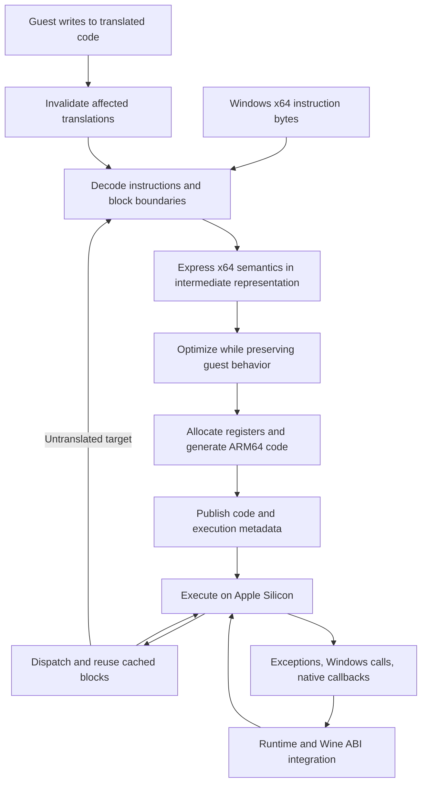

# Engine ownership, language choices, and Cranelift

Research date: September 27, 2026. This document records inspected upstream source and engineering recommendations. It does not report a working Pear CPU translator or Rosetta-free Megabonk execution.

## Recommendation

Pear should own a coherent compatibility runtime: reproducible builds, native macOS integration, component interfaces, compatibility patches, validation, diagnostics, and releases. Reusing FEX, Wine, and DXMT does not prevent that ownership. A collection of downloaded binaries and undocumented settings would not meet this standard.

Rust is **optional**, chosen per subsystem. Retain upstream implementation languages for the first CPU, Windows API, and graphics integration. Evaluate Rust for new management and verification software where memory safety, explicit state transitions, and a portable CLI are useful. A native macOS application may reasonably use Swift with a small C/Objective-C bridge instead.

Keep an independent CPU-engine research track, including Cranelift, but do not make a new translator a prerequisite for the first milestone. Promote that work only after it demonstrates a specific advantage against a reproducible FEX baseline, passes a declared correctness suite, and has a viable macOS execution and maintenance path. No performance or schedule advantage is established by this research.

## What a CPU translator actually contains

The following is a conceptual dynamic binary translation (DBT) pipeline. Implementation details differ between engines.



An intermediate representation (IR) describes operations and their relationships in a form that a compiler can transform. Decoding identifies an instruction; *semantic lifting* expresses everything that instruction must do, including effects on registers, flags, memory, and faults. Decoding alone is insufficient.

The translator must maintain guest CPU state and execution boundaries while generated ARM64 code runs. Windows API compatibility and Direct3D graphics translation remain separate responsibilities. Caching translated blocks reduces repeated compilation, but does not reconstruct a Unity project or turn the game into an independent native Mac application.

This separation is visible in current FEX source: `Frontend.cpp` decodes instructions, `OpcodeDispatcher.cpp` builds IR and manages guest flags/registers, and `JIT/JIT.cpp` consumes IR and allocates ARM64 code in shared buffers. Its ARM64EC module contains thread-state, Wine-call, exception, and invalidation integration. These are substantial existing assets, not features supplied by choosing a programming language. [F1–F4]

## What Cranelift supplies

Cranelift is a code-generation library written in Rust and developed in the Wasmtime project. Its principal job is:

```text
Cranelift IR → optimization / instruction selection / register allocation → machine code
```

It has an AArch64 backend and support for the Apple AArch64 calling convention. Its use in Wasmtime means it can participate in a WebAssembly runtime; it also supports non-WebAssembly frontends. Those capabilities do not make it an x64 binary translator, PE loader, Windows API implementation, or Direct3D implementation. Its x64 backend means it can *generate* x64 code; it does not mean it accepts a Windows x64 executable as input. [C1]

For a Pear DBT, Cranelift could replace part of the **code-generation backend**. Pear would still need an x64 decoder and semantics frontend, guest-state representation, dispatcher, memory model, cache invalidation, exception reconstruction, and Wine integration. An x64 decoder library could reduce decoding work without supplying those other layers.

The inspected `CallConv` enumeration includes `AppleAarch64` and `WindowsFastcall`, but no explicit ARM64EC convention. That observation does not prove integration is impossible: a runtime may use its own internal convention and explicit transition stubs. It does mean ordinary ARM64 or Windows calling-convention support is not evidence of complete ARM64EC interoperability. That must be designed and tested. Microsoft's ARM64EC specification describes additional register, entry/exit, and interoperability rules. [C2, M1]

The inspected Cranelift JIT memory code clears the instruction cache and changes generated memory to executable. This is a useful implementation reference, not evidence that its default JIT embedding satisfies Pear's entire signed macOS/Wine environment. Code generation, memory publication, runtime permissions, and distribution are separate responsibilities. [C3, A1]

## Correctness obligations that a language rewrite does not remove

| Area | Required behavior and concrete research question |
|---|---|
| Integer state and flags | Preserve partial-register writes, operand widths, carry/overflow/parity behavior, shifts, and control flow. Can optimizations avoid unnecessary flag computation without changing visible state? |
| SIMD and floating point | Implement the instructions the game and its libraries use, including lane semantics, rounding and exceptional values. A backend's vector support is not a promise of all x86 SIMD or floating-point semantics. |
| Memory ordering | Preserve guest ordering across threads while running on ARM. Explicitly model ordinary accesses, atomics, fences, alignment, and cross-page behavior; do not assume Rust atomics or host loads automatically implement x86 rules. |
| Exceptions and interruption | Map host execution back to the correct guest instruction and state. Test faults, Windows exception handling, suspension/resumption, and callbacks through native code. |
| Dynamically changed code | Detect or coordinate writes, protection changes, and reused addresses. Invalidate stale blocks safely while other threads may execute or compile them. |
| ABI transitions | Preserve registers, stack layout, thread-local data, return values, unwinding, and callback direction across translated x64, ARM64EC, and native host code. |
| Executable memory | Allocate and publish generated code under the supported macOS memory and signing rules; synchronize instruction caches and lifetime correctly. |
| Cache portability | Bind persistent entries to the actual guest bytes, translator build, options, ABI assumptions, and host features. Reject stale or incompatible entries; do not treat cached code as a portable application. |

The memory-ordering issue is particularly important: x86 and ARM expose different ordering guarantees, and alignment/atomicity are additional concerns. FEX discusses these problems and contains dedicated atomic lowering and recovery mechanisms. A proposal to disable correctness mechanisms for speed must not silently become a game profile. [F5, F6]

Cranelift's inspected atomic IR operations are sequentially consistent. That does not eliminate the need to model ordinary guest loads/stores, nor show that mapping every guest access to the strongest available operation is an efficient design. The correct mapping and generated code need measurement. [C4]

Apple documents JIT memory rules, including `MAP_JIT`, write/execute transitions, and the Hardened Runtime's `allow-jit` entitlement. Wine's additional compatibility execution requirements must be investigated separately. Rust, Cranelift, LLVM, and a handwritten ARM64 emitter all remain subject to the host's execution rules. [A1]

## Implementation options

The tradeoffs below are engineering assessments based on the responsibilities above, not measured Pear performance results.

| Option | Reuse and potential value | Costs and unresolved questions | Recommendation |
|---|---|---|---|
| Integrate FEX in its current language | Retains its decoder, x64 semantics, IR, ARM64 backend, tests, and ARM64EC work. Focuses new work on macOS and complete runtime integration. | Source/patch availability, supported execution permissions, ABI behavior, and distribution still need proof. Upstream changes require maintained integration tests. | First implementation candidate. A substantial, maintained macOS port is justified if required and reproducible. |
| Maintain a focused FEX downstream branch | Lets Pear own necessary platform work, diagnostics, and targeted fixes while preserving upstream provenance. | Review/rebase burden, long-lived divergence, licensing, and responsibility for unsupported patches. | Accept only with an explicit patch series, owners, rationale, and regression coverage. Do not call the result an independently implemented translator. |
| Add selected Rust components around retained C/C++ | Can improve new manifest, package, state-management, and diagnostics code without discarding CPU compatibility work. | Adds a toolchain and FFI boundaries; safe Rust does not validate foreign code or generated machine code. | Reasonable when the boundary is narrow and maintained. Prefer a process/CLI protocol for management functions that do not need hot-path calls. |
| Rewrite FEX in Rust | Could redesign interfaces and reduce some implementation memory-safety hazards. | Reimplements or revalidates the same CPU behavior; complicates upstream reuse; does not solve macOS permission or ABI gaps by itself. | No demonstrated reason to make it the milestone path. Require a problem statement and a bounded experiment first. |
| New frontend/runtime with Cranelift | Reuses compiler optimization, register allocation, and ARM64 code generation; permits a Rust-oriented implementation. | Still owns almost all emulation semantics and runtime integration. Generic IR must preserve precise guest behavior. API/version changes and backend fit need evaluation. | Separate research track with correctness and comparative gates. |
| New frontend/runtime with LLVM ORC | Reuses LLVM optimization/code generation and modular JIT facilities, including IR compilation, linking, lazy materialization, and concurrency. [L1] | Still needs semantic lifting and a guest runtime. Integration size, compilation latency, and optimizer assumptions need measurement, not slogans about LLVM being faster or slower. | An alternative experimental backend when a concrete optimization hypothesis warrants it. |
| New frontend and custom ARM64 emitter | Gives control over guest-specific lowering, code layout, flags, and runtime transitions. | Pear owns instruction selection, register allocation, relocation, host-feature handling, debugging support, and correctness tests in addition to the frontend. | Consider only after a specific backend limitation is demonstrated. |

LLVM IR has explicit rules for undefined behavior, poison, overflow flags, floating point, and memory. A binary lifter must encode guest behavior without accidentally authorizing optimizations that change it. An LLVM backend is therefore not a direct conversion of EXE bytes to equivalent ARM64 code. [L2]

## Language policy by subsystem

| Subsystem | Defensible language choice | Decision rule |
|---|---|---|
| FEX CPU engine and existing port work | Retain C++ and existing assembly | Follow upstream conventions and minimize semantic changes unrelated to the port. |
| Wine and ABI/platform integration | Retain C and required assembly/Objective-C | Interoperate with the existing codebase and preserve reviewability of platform changes. |
| DXMT and graphics integration | Retain the upstream languages/toolchain | Evaluate graphics behavior and supported build targets before considering any rewrite. |
| Runtime manifests, package verification, profiles, diagnostics | Rust, Swift, or an existing maintainable systems implementation | Select for contributor expertise, dependency footprint, testing, and the interface contract. Rust is a strong candidate, not a requirement. |
| Native Mac interface | Swift/AppKit or another accessible native interface | Favor maintainable platform integration; do not require a web UI or Rust frontend. |
| Reproducible build and test orchestration | Existing CMake/Meson tools plus small Python or shell utilities | Keep the build readable; avoid recreating upstream build systems. |
| CPU-backend experiment | Rust with Cranelift, or C++ with LLVM/custom emission | Choose after defining the semantics and measurements. Using Rust here does not require Rust everywhere else. |

Where Rust crosses into C/C++ or executable memory, require documented ownership, thread affinity, lifetime, error, and unwinding contracts. Keep guest memory separate from ordinary safe-language references whose aliasing rules it may not satisfy. Rust's FFI documentation explicitly places responsibility on these boundaries. Memory safety in the compiler implementation also does not prove that the generated code faithfully implements the guest ISA. [R1]

## What it means to build Pear's own engine

There are three materially different ambitions:

1. **Pear compatibility engine:** a Pear-maintained runtime distribution and platform integration, with specified boundaries, source provenance, patched components, tests, observability, release policy, and compatibility records. This is a defensible goal even when its CPU and graphics implementations are reused.
2. **Pear CPU translation engine:** an independently maintained DBT that can replace the CPU component while continuing to use Wine and a graphics layer. Technically possible, but compatibility breadth and engineering sustainability remain unproven. It requires a separate research program and maintainers, not merely a backend selection.
3. **Independent CPU, Windows API, and graphics stack:** a substantially wider effort that repeats multiple independent compatibility projects. Nothing established so far shows that this is necessary to meet Pear's mission. Adopt it only to address documented constraints that reuse cannot resolve.

The first ambition is meaningful engineering ownership. It should include architectural choices, native platform work, regression prevention, and a reproducible support contract. Pear should neither minimize that work as a launcher wrapper nor imply that reused engines were invented by Pear.

Rosetta independence is a dependency property. It does not imply independence from macOS, Apple's execution policies, Metal, Steam, or upstream maintenance. A distinct engine name cannot substitute for documenting those dependencies.

## Standalone CPU-engine research track

This track may proceed beside the production integration work. Completing one experiment does not automatically authorize replacing the baseline. Each result must record toolchain versions, commit hashes, hardware, settings, test inputs, and unresolved cases.

### E0 — A falsifiable reason to change the backend

Identify a reproducible deficiency: unavailable required platform support, a demonstrated correctness issue, an unsuitable interface, or a measured hot path. Produce a minimal reproduction and profile that distinguish translation/dispatch cost from Wine, graphics, shaders, I/O, and game simulation.

**Exit:** a written hypothesis and measurable comparison. If the bottleneck lies elsewhere, address that layer instead. Do not start a rewrite from an unmeasured expectation that Rust is faster.

### E1 — CPU semantics and differential harness

Define a bounded instruction subset and an explicit guest-state format. Execute the same generated and adversarial test cases on an x86-64 reference and the proposed engine, comparing defined register, flag, memory, and fault outcomes. Mask architecturally undefined outcomes deliberately. Record unsupported instructions as unsupported; never skip them silently.

Reuse suitable FEX assembly tests where licensing and their execution assumptions permit. The inspected FEX harness includes native-host and JIT configurations, special handling for self-modifying-code tests, and known/disabled-test lists. Port the harness deliberately: a Linux-oriented test runner is not automatically a native macOS harness. Its ordinary assembly test configurations also disable TSO, so passing them alone cannot validate threaded memory ordering. [F7]

**Exit:** all declared subset tests pass against the reference with a reviewable exception list and minimized reproductions for discrepancies. A scalar subset is a research result, not a game compatibility claim.

### E2 — One frontend, two backend experiments

Feed equivalent, explicitly defined guest semantics to Cranelift and the chosen comparison backend. Measure cold translation latency, generated code size, dispatcher overhead, steady execution, memory use, and cache behavior. Include branch-heavy, SIMD, atomic, and callback-boundary workloads as the supported subset expands.

**Exit:** repeatable results with identical correctness requirements. Set an acceptable regression budget and the intended improvement *before* selecting a winner. If there is no material benefit relevant to E0, retain the existing engine; do not invent a benefit from microbenchmarks alone.

### E3 — Runtime obligations on signed macOS

Exercise faults and guest-state reconstruction, cross-thread invalidation, dynamically changed code, nested native callbacks, cancellation, and executable-memory publication in the intended signed application environment. Add memory-ordering litmus/stress tests that are not covered by single-thread arithmetic tests.

**Exit:** documented, repeatable behavior under the proposed normal distribution setup. A build that works only through a developer-specific workaround does not establish a distributable Pear engine.

### E4 — Wine CPU-module integration

Implement the chosen Wine/ARM64EC boundary rather than introducing a new Windows API implementation. Validate thread lifecycle, exception contexts, TLS, system-call/native transitions, and both callback directions with small PE fixtures before D3D or a game. Keep the existing runtime selectable as a comparison; label every experimental result by backend.

**Exit:** the published fixture suite passes with traceable CPU-module provenance and architecture evidence. Do not infer this from a macOS command-line JIT demo.

### E5 — Adoption decision

Run the same game validation used by the first milestone, including all required helpers, input/audio, saving/loading, and sustained play. Compare repeatability, failures, frame times, memory and power under controlled settings. Include cold and warm caches without assuming warm-cache results describe first use.

**Exit:** an architecture decision records demonstrated advantages, remaining compatibility gaps, a support owner, maintenance cost, source/license obligations, and a rollback path. If the experiment fails the agreed gates, publish the research result and retain the validated production engine. An experiment can be useful without becoming the product default.

## Upstream collaboration and source provenance

At the inspected FEX revision, `CONTRIBUTING.md` states: **“No AI/ML/LLM/etc code contributions.”** Pear must respect that policy and must not promise to submit assistant-generated FEX patches upstream or obscure their origin. This is a contribution rule, distinct from license-based reuse. Changes in Pear's own project and downstream maintenance need clear provenance and their own review policy. [F8]

Any reused code and tests retain their applicable notices and license obligations. A downstream name or language conversion does not erase those obligations. Source revisions below are research snapshots, not approved production pins; production pins must come from a successfully reproduced and validated build.

## Inspected primary sources

Source inspections used GitHub's public API and raw files on September 27, 2026. The inspected `main` snapshots were:

- FEX: [`59f85d6b7df4eb053d2cc1b9d33411b4f31bfbaa`](https://github.com/FEX-Emu/FEX/commit/59f85d6b7df4eb053d2cc1b9d33411b4f31bfbaa), committed September 26, 2026.
- Wasmtime/Cranelift: [`11eac9de8693e1a69f86815d1a58918edd5c1785`](https://github.com/bytecodealliance/wasmtime/commit/11eac9de8693e1a69f86815d1a58918edd5c1785), committed September 26, 2026.

| Ref | Primary source |
|---|---|
| F1 | [FEX instruction decoding: Frontend.cpp](https://github.com/FEX-Emu/FEX/blob/59f85d6b7df4eb053d2cc1b9d33411b4f31bfbaa/FEXCore/Source/Interface/Core/Frontend.cpp) |
| F2 | [FEX semantic lowering: OpcodeDispatcher.cpp](https://github.com/FEX-Emu/FEX/blob/59f85d6b7df4eb053d2cc1b9d33411b4f31bfbaa/FEXCore/Source/Interface/Core/OpcodeDispatcher.cpp) |
| F3 | [FEX ARM64 backend: JIT.cpp](https://github.com/FEX-Emu/FEX/blob/59f85d6b7df4eb053d2cc1b9d33411b4f31bfbaa/FEXCore/Source/Interface/Core/JIT/JIT.cpp) |
| F4 | [FEX ARM64EC module](https://github.com/FEX-Emu/FEX/blob/59f85d6b7df4eb053d2cc1b9d33411b4f31bfbaa/Source/Windows/ARM64EC/Module.cpp) and [ARM64EC integration documentation](https://wiki.fex-emu.com/index.php/Development:ARM64EC) |
| F5 | [FEX discussion of x86 memory-ordering emulation](https://fex-emu.com/Scourge-of-emulation/) |
| F6 | [FEX ARM64 atomic operations](https://github.com/FEX-Emu/FEX/blob/59f85d6b7df4eb053d2cc1b9d33411b4f31bfbaa/FEXCore/Source/Interface/Core/JIT/AtomicOps.cpp) |
| F7 | [FEX assembly test configuration](https://github.com/FEX-Emu/FEX/blob/59f85d6b7df4eb053d2cc1b9d33411b4f31bfbaa/unittests/ASM/CMakeLists.txt) and [test runner build](https://github.com/FEX-Emu/FEX/blob/59f85d6b7df4eb053d2cc1b9d33411b4f31bfbaa/Source/Tools/TestHarnessRunner/CMakeLists.txt) |
| F8 | [FEX contribution policy](https://github.com/FEX-Emu/FEX/blob/59f85d6b7df4eb053d2cc1b9d33411b4f31bfbaa/CONTRIBUTING.md) |
| C1 | [Cranelift overview](https://github.com/bytecodealliance/wasmtime/blob/11eac9de8693e1a69f86815d1a58918edd5c1785/cranelift/README.md) |
| C2 | [Cranelift calling-convention enumeration](https://github.com/bytecodealliance/wasmtime/blob/11eac9de8693e1a69f86815d1a58918edd5c1785/cranelift/codegen/src/isa/call_conv.rs) and [AArch64 ABI implementation](https://github.com/bytecodealliance/wasmtime/blob/11eac9de8693e1a69f86815d1a58918edd5c1785/cranelift/codegen/src/isa/aarch64/abi.rs) |
| C3 | [Cranelift JIT memory protection and cache synchronization](https://github.com/bytecodealliance/wasmtime/blob/11eac9de8693e1a69f86815d1a58918edd5c1785/cranelift/jit/src/memory/mod.rs) |
| C4 | [Cranelift IR instruction definitions](https://github.com/bytecodealliance/wasmtime/blob/11eac9de8693e1a69f86815d1a58918edd5c1785/cranelift/codegen/meta/src/shared/instructions.rs) |
| L1 | [LLVM ORC design](https://llvm.org/docs/ORCv2.html) |
| L2 | [LLVM Language Reference](https://llvm.org/docs/LangRef.html) |
| M1 | [Microsoft ARM64EC ABI specification](https://learn.microsoft.com/en-us/windows/arm/arm64ec-abi) |
| A1 | [Apple: porting JIT compilers to Apple silicon](https://developer.apple.com/documentation/apple-silicon/porting-just-in-time-compilers-to-apple-silicon) |
| R1 | [Rust foreign-function interface and unwinding guidance](https://doc.rust-lang.org/nomicon/ffi.html) |
